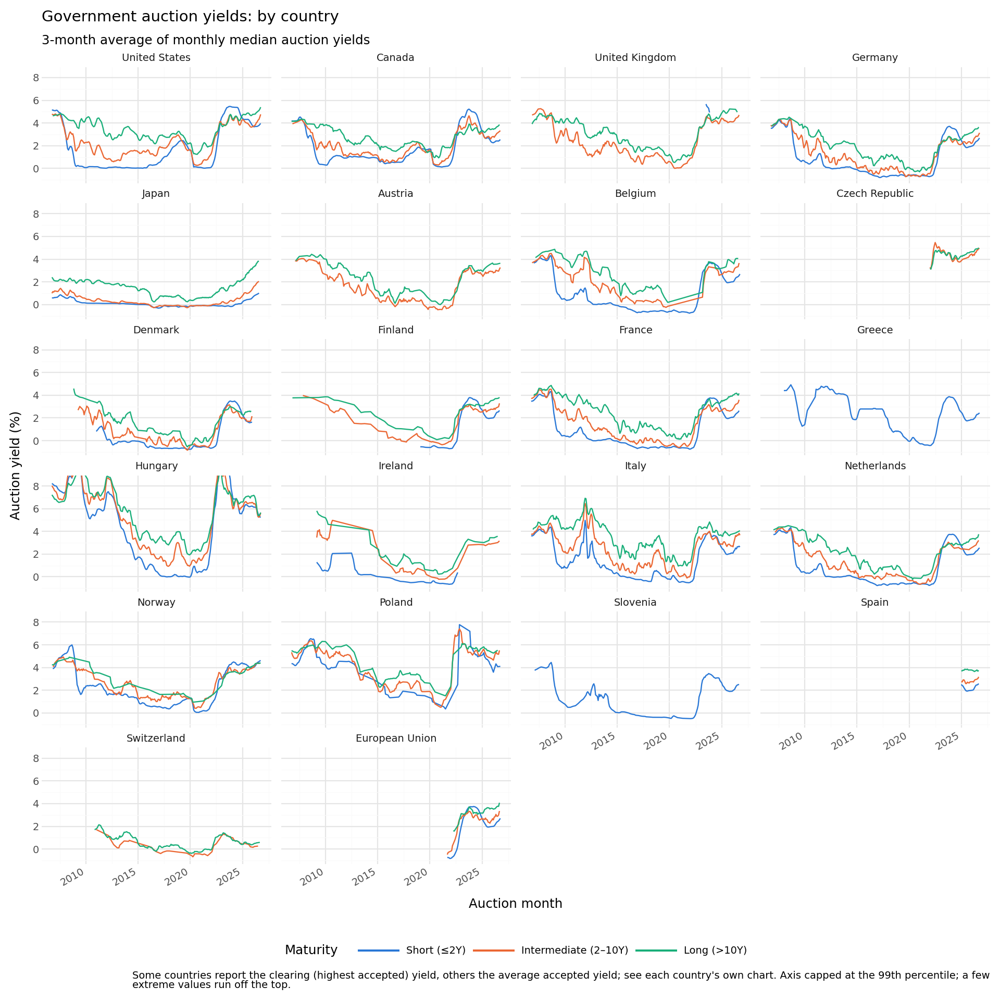
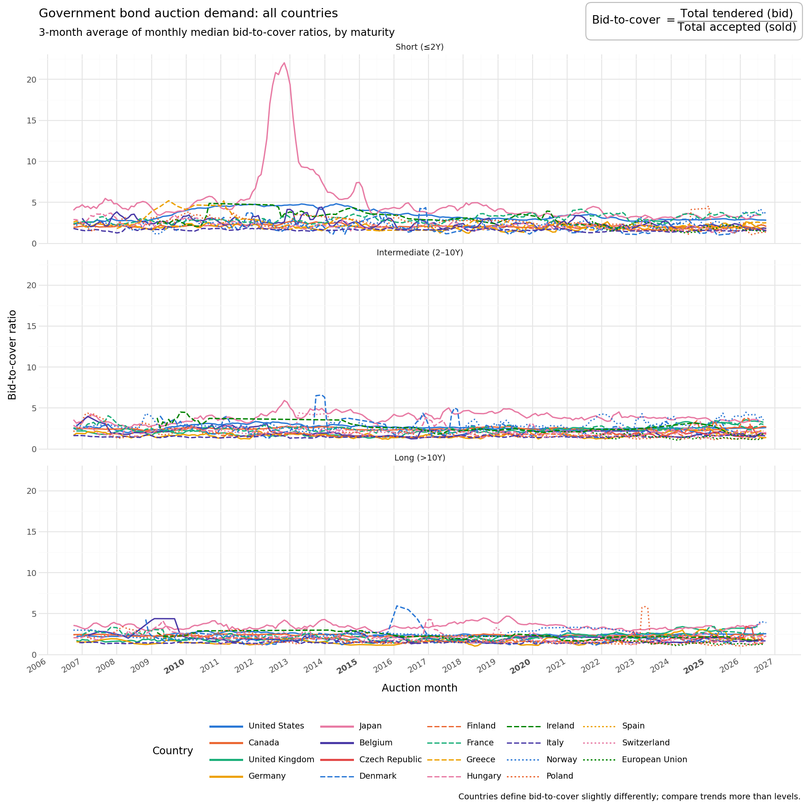
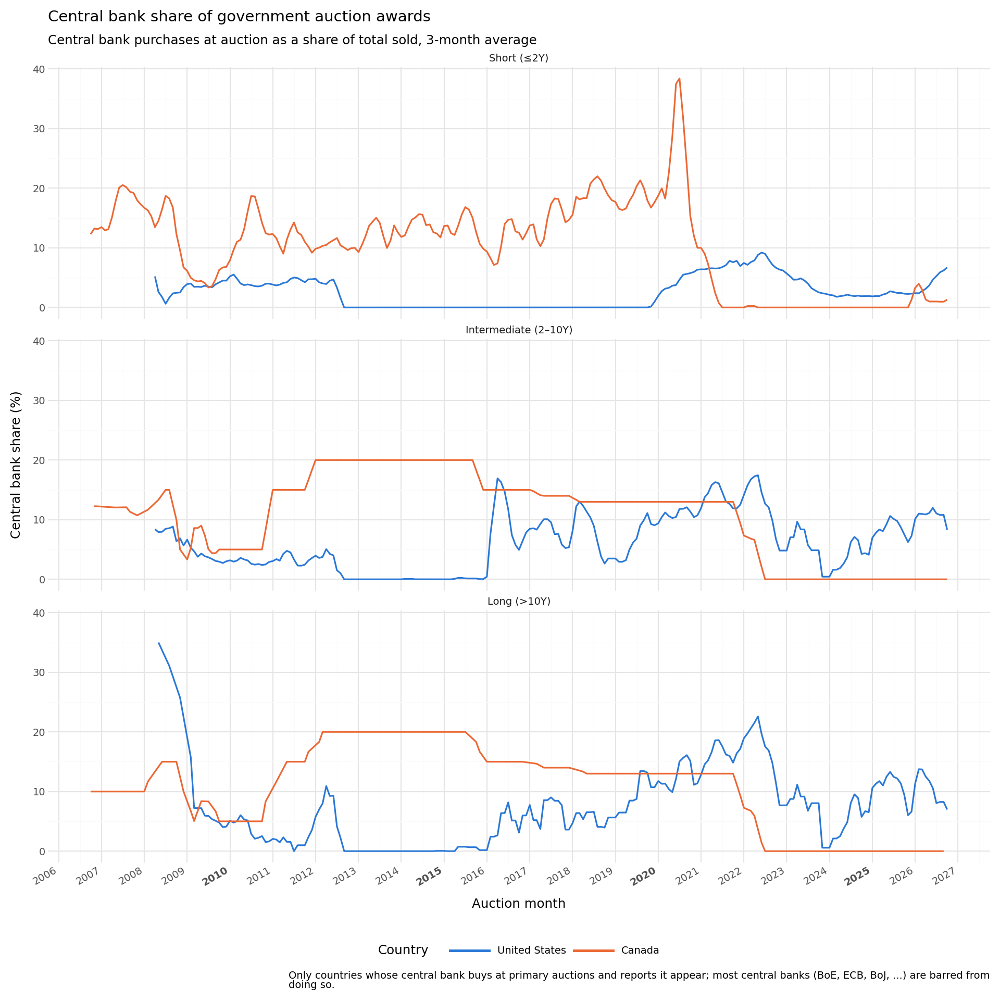
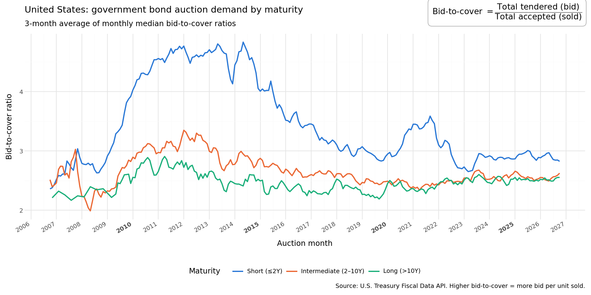
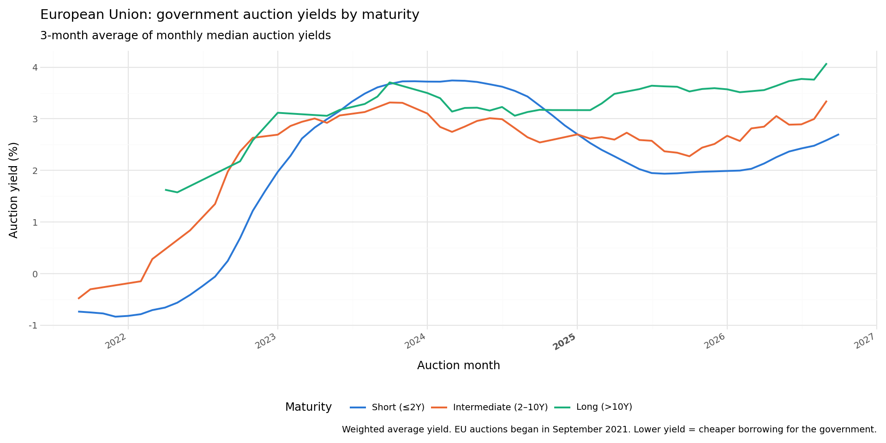

# Government bond auction demand across OECD countries

Downloads government bond and bill **auction results** from each OECD country's
official debt office or central bank (plus the European Union's own
auctions), then charts demand (bid-to-cover), volume, yields and, where the
central bank buys at auction, the central bank's share, over the last 20
years, broken down by maturity.



## Run it

```bash
pip install -r requirements.txt
python treasurydata.py
```

Each run creates a dated folder:

```
runs/2026-10-10_124747_20y/
  auction_totals.csv          auctions per country and maturity bucket
  us/  canada/  france/ ...   one folder per country: charts + monthly CSV
  global/                     every country together
```

Change the lookback window with `YEARS` at the top of `treasurydata.py`.
If one country's website is down, the run prints a warning and carries on.

## What the charts show

| Measure | Meaning |
|---|---|
| **Bid-to-cover** | Total bids ÷ amount sold. Higher = more competition for the debt. |
| **Volume** | Gross amount sold at auction, in local currency (not net new borrowing). |
| **Auction yield** | The interest rate the auction cleared at (or the average accepted yield, depending on the country). |
| **Central bank share** | Central bank purchases at auction ÷ amount sold. Most central banks are legally barred from buying at their own government's auctions, so this exists only where it actually happens. |

Auctions are grouped by time to maturity: **Short** (≤2 years), **Intermediate**
(2–10 years), **Long** (>10 years). Monthly figures are medians (bid-to-cover,
yield) or sums (volume), smoothed with a 3-month rolling average.

Countries define these measures slightly differently (e.g. clearing vs average
yield), so compare **trends** across countries more than exact levels.

On the global charts each country has a fixed colour and line style (eight
colours × solid/dashed/dotted), so it looks the same on every chart and run.
The `_grid` versions give each country its own small panel instead.

## Example charts

These come from the run of 10 October 2026. Each run writes its own copies to
`runs/`; the images here are just a snapshot for this page.

**Demand at auction, all countries.** Bid-to-cover by maturity, one line per
country. The spike is Japan in 2012-13, when bill yields were stuck at the Bank
of Japan's 0.1% floor and bids reached over 20 times the amount sold.



**Central bank share of auctions.** Only the Fed and the Bank of Canada buy at
their own government's auctions. The Bank of Canada's fixed shares (20%, then
15%, 13%) stop in 2022 when it ended bond purchases at auction; the Fed's share
follows its maturing holdings, which it reinvests at auction.



**One country in detail: United States.** Every country gets its own folder of
charts like this one, plus a monthly CSV.



**European Union.** The EU's own EU-Bills and EU-Bonds, auctioned by the
European Commission since 2021: yields rose from below zero to around 3-4% as
the ECB raised rates in 2022-23.



## Coverage

### Included (21 countries + the EU)

| Country | Source | From | Bid-to-cover | Yield used | Central bank share | Notes |
|---|---|---|:-:|---|:-:|---|
| United States | U.S. Treasury Fiscal Data API | 2006 | ✓ | Clearing (high yield) | ✓ (Fed) | Also non-primary-dealer share |
| Canada | Bank of Canada Valet API | 2006 | ✓ | Clearing (high yield) | ✓ (BoC) | |
| United Kingdom | UK Debt Management Office | 2006 | ✓ | Average (yield at average accepted price) | | Gilts only; T-bills are sold separately |
| Germany | Finanzagentur | 2006 | ✓ | Average (weighted average yield) | | |
| Japan | Ministry of Finance | 2006 | ✓ | Clearing (yield at lowest accepted price) | | Published with a ~1 month lag |
| Austria | OeKB (auction agent) | 2007 | | Issue yield (as published) | | Bonds only; total bids not published |
| Belgium | Belgian Debt Agency | 2006 | ✓ | Average (weighted average yield) | | Parsed from PDFs |
| Czech Republic | Czech National Bank | 2022 | ✓ | Clearing (maximum accepted yield) | | Downloadable history starts in 2022 |
| Denmark | Danmarks Nationalbank | 2008 | ✓ | Clearing (cut-off price/rate) | | Files run to the end of last year |
| Finland | State Treasury open data API | 2006 | ✓ | Issue yield (as published) | | Mostly syndications before 2019 |
| France | Agence France Trésor | 2006 | ✓ | Average (weighted average rate) | | |
| Greece | Public Debt Management Agency | 2008 | ✓ | Uniform price (clearing = average) | | Bills only (bonds mostly syndicated) |
| Hungary | ÁKK (via its website's data API) | 2006 | ✓ | Clearing (maximum accepted yield) | | |
| Ireland | NTMA | 2009 | ✓ | Issue yield (as published) | | Bill history ends in 2022 |
| Italy | Banca d'Italia | 2006 | ✓ | Allotment yield (see note) | | |
| Netherlands | Dutch State Treasury Agency | 2007 | | Issue yield (as published) | | Bids not published |
| Norway | Norges Bank | 2006 | ✓ | Issue yield (as published) | | |
| Poland | Ministry of Finance | 2006 | ✓ | Clearing (maximum accepted yield) | | |
| Slovenia | Ministry of Finance | 2007 | | Issue rate (as published) | | Bills only; bids not published |
| Spain | Tesoro Público | 2025 | ✓ | Clearing (stop-out/marginal rate) | | Only the last two years are published in bulk |
| Switzerland | Federal Finance Administration / SNB | 2010 | ✓ | Uniform price (clearing = average) | | Bonds only |
| **European Union** (not a country) | European Commission | 2021 | ✓ | Average (weighted average yield) | | EU-Bonds and EU-Bills; see below |

**European Union.** The EU borrows in its own name (e.g. for NextGenerationEU),
with auctions run by the European Commission since September 2021. It's
treated like a country, with its own `eu/` folder and a place on the global
charts. The ECB is the euro area's central bank but, like the national central
banks, is barred from buying at primary auctions, so there's no central bank
share. The Commission publishes one web page per auction, so the first run
fetches a few hundred pages slowly (the site rate-limits) and caches them in
`cache/`; later runs only fetch new auctions.

**Yield used:**
- **Clearing:** the highest yield accepted, i.e. the auction's cut-off. Every
  winning bidder got that yield or a lower one.
- **Average:** the weighted average of all accepted bids, which sits slightly
  below the clearing yield.
- **Uniform price:** every winner pays the same price, so clearing and average are
  the same number.
- **Issue yield (as published):** the source gives one yield per auction without
  saying whether it is the clearing or the average yield.
- **Italy:** the allotment yield is the clearing yield for bonds, which are sold at
  a single price, and the weighted average yield for BOT bills.

Inflation-linked and floating-rate securities are excluded everywhere (as US
TIPS and FRNs are), because they don't quote comparable nominal yields.

### Not included yet (17 countries)

| Country | Why |
|---|---|
| Australia | AOFM's site doesn't respond to automated downloads |
| New Zealand | Debt Management site sits behind a browser-only bot check (Cloudflare) |
| Sweden | Riksgälden's auction statistics are only in an interactive QlikView dashboard |
| Portugal | IGCP's site blocks automated requests (HTTP 403) |
| South Korea | Results are one file per auction; bulk data needs a free Bank of Korea ECOS API key |
| Mexico | Full history needs a free Banxico SIE API token |
| Turkey | Results are one PDF per auction; bulk data needs a free CBRT EVDS API key |
| Israel | Results are published on Bloomberg; no bulk public download found |
| Chile | Historical files on the Finance Ministry's old site stop in 2020 |
| Colombia | No bulk download of TES auction results found |
| Iceland | Results are one web page/PDF per auction |
| Slovakia | Results are one PDF per auction |
| Lithuania | Nasdaq Baltic only offers the latest auctions, without maturities |
| Latvia | Results are only in individual news releases |
| Estonia | Very little domestic auction issuance |
| Luxembourg | Issues by syndication, not auction |
| Costa Rica | No bulk download found |

Countries marked "needs a free API key" can be added once a key is available.

## Project layout

```
treasurydata.py      entry point: runs every country, writes the run folder
common.py            shared bucketing, monthly aggregation and charts
countries/
  __init__.py        list of countries to run
  _http.py           download helpers
  <country>.py       one loader per country (eu.py for the European Union)
cache/               downloaded EU auction pages (gitignored)
docs/images/         example charts shown in this README
```

### Adding a country

Write `countries/<name>.py` with a `fetch(start, end)` function that returns one
row per auction with these columns, plus a `COUNTRY` describing it (see any
existing loader), then add it to `countries/__init__.py`:

| Column | Meaning |
|---|---|
| `auction_date` | Date of the auction |
| `maturity_date` | Date the security is repaid |
| `bid_to_cover` | Total bid ÷ amount sold (NaN if not published) |
| `accepted` | Amount sold, in local currency units |
| `auction_yield` | Yield in percent (NaN if not published) |
| `cb_accepted` | Central bank purchases at the auction (NaN if none or not reported) |

Charts for any measure a country doesn't publish are skipped automatically.

## Caveats

- Several sources aren't formal APIs (Hungary's website data endpoint, Belgium's
  PDFs, Greece's web tables), so a site redesign can break a loader. When that
  happens the run reports the failure for that country and continues.
- Volumes are in each country's own currency, so the global charts compare
  bid-to-cover, yields and central bank share, not volume.
